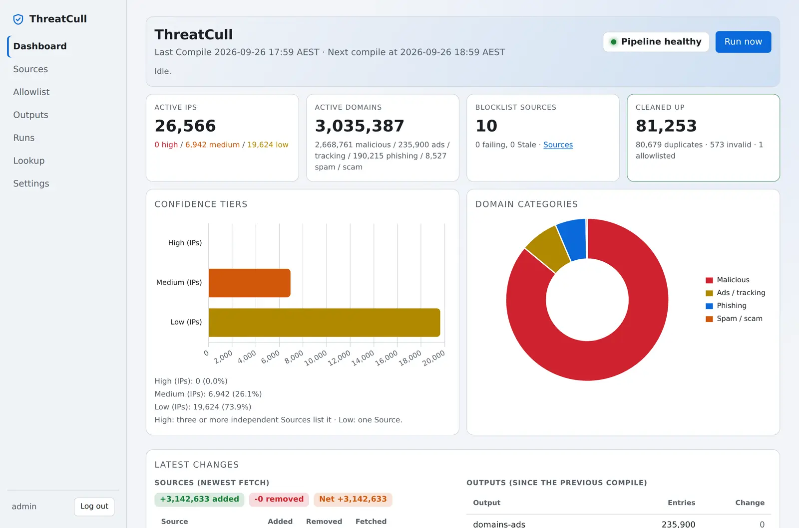
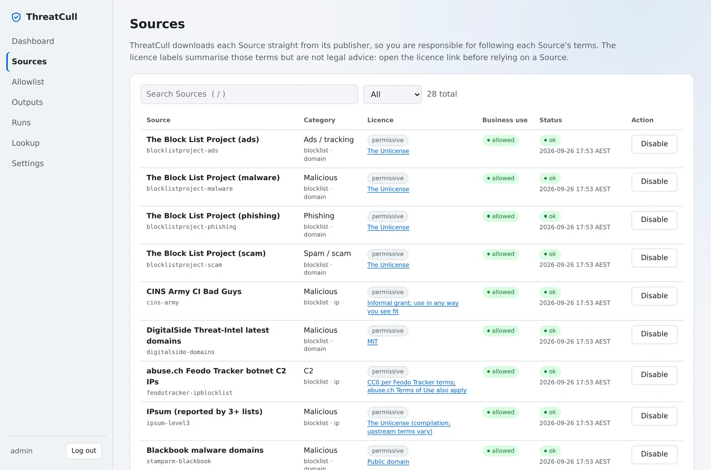
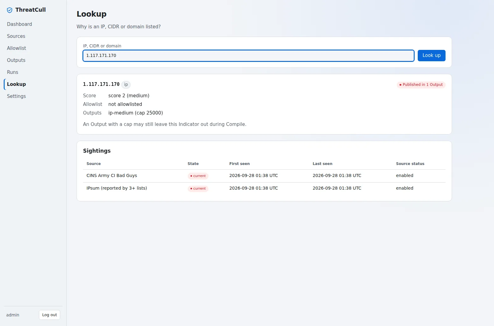

# ThreatCull

[](https://github.com/spydisec/threatcull/releases/latest)
[](https://coderabbit.ai)
[](https://github.com/spydisec/threatcull/actions/workflows/image-scan.yml)
[](https://github.com/spydisec/threatcull/pkgs/container/threatcull)
[](pyproject.toml)
[](LICENSE)
[](https://deepwiki.com/spydisec/threatcull)

ThreatCull is a self-hosted threat-feed compiler. It downloads public blocklists, drops duplicates,
private ranges and your own infrastructure, scores each indicator by how many independent sources list
it, and serves the result to your firewalls, DNS servers and SIEM.

It's for anyone who runs a firewall, DNS filter or SIEM and wants one curated blocklist instead of many
raw ones. ThreatCull ships no threat data and doesn't block traffic itself: your devices fetch its
lists.

```text
sources ──> drop duplicates, private ranges, your allowlist ──> score by source agreement ──> feed URLs
```

- [Catalog](docs/CATALOG.md) of public blocklist sources, plus your own sources (URL or local file)
- Built-in CDN allowlists, your own entries and your own allowlist URLs; mark your own network to
  get an alert when a source lists it
- Confidence tiers (high, medium, low) from source agreement
- Outputs as plain, hosts, AdGuard, RPZ, CSV or JSON, each at its own URL, protected by a Feed
  Token (a secret in the URL)
- Web UI with a dashboard, lookup, run history and a built-in scheduler
- Works without internet access, and without a domain name or TLS certificate

A short tour of the web UI:

https://github.com/user-attachments/assets/d78a93ce-2fdb-4fbf-9664-20ed0162c54a

<table>
  <tr>
    <td width="33%" align="center">
      <a href="docs/images/dashboard-light.webp"><picture><source media="(prefers-color-scheme: dark)" srcset="docs/images/dashboard-dark.webp"></picture></a>
      <br><sub><b>Dashboard</b></sub>
    </td>
    <td width="33%" align="center">
      <a href="docs/images/sources-light.webp"><picture><source media="(prefers-color-scheme: dark)" srcset="docs/images/sources-dark.webp"></picture></a>
      <br><sub><b>Sources</b></sub>
    </td>
    <td width="33%" align="center">
      <a href="docs/images/lookup-light.webp"><picture><source media="(prefers-color-scheme: dark)" srcset="docs/images/lookup-dark.webp"></picture></a>
      <br><sub><b>Lookup</b></sub>
    </td>
  </tr>
</table>

<sub>Click a screenshot to open it full size.</sub>

## Quick start

You need Docker with Compose. The image is published for amd64 and arm64. On a small host such as a
Raspberry Pi, read [Sizing](#sizing) first. Platform support:

| Platform | Status |
| --- | --- |
| Docker on Linux, amd64 or arm64 (servers, VMs, a Raspberry Pi with a 64-bit OS) | Supported and tested |
| Docker Desktop on Windows (WSL 2) or macOS | Runs the same Linux image; not tested |
| 32-bit ARM, such as 32-bit Raspberry Pi OS | Not supported: no image is published |
| Windows without Docker | Not supported: use Docker Desktop or WSL 2 |

The compose file you download below stores data in a named volume, `threatcull-data`. Keep it,
especially on Docker Desktop. Don't mount a Windows folder (such as `C:\threatcull`) as `/data`: the
SQLite database needs file locking that such mounts don't provide reliably, and the database can
lock up or corrupt.

To start ThreatCull:

1. Download the compose file:

   ```bash
   curl -fsSLO https://raw.githubusercontent.com/spydisec/threatcull/main/docker-compose.yaml
   ```

2. Set `THREATCULL_ADMIN_PASSWORD` in `docker-compose.yaml` (12 or more characters).
3. Start the container:

   ```bash
   docker compose up -d
   ```

4. Open `http://<server-ip>:6969` and log in as `admin`.

ThreatCull reads the password on the first start only; you can clear it from the file afterwards.

**Portainer:** go to **Stacks > Add stack**, paste the contents of `docker-compose.yaml`, set the
password, then click **Deploy**.

### Air-gapped install

On a machine with internet access, pull and save the image:

```bash
docker pull ghcr.io/spydisec/threatcull:2
docker save ghcr.io/spydisec/threatcull:2 -o threatcull.tar
```

Copy `threatcull.tar` and `docker-compose.yaml` to the air-gapped machine, then load the image there:

```bash
docker load -i threatcull.tar
```

Start it with `docker compose up -d`. Catalog Sources download from the internet, so on an
air-gapped host you supply each list yourself. Copy a list into the volume (the file must be
readable by everyone, mode 644):

```bash
docker compose cp mylist.txt threatcull:/data/imports/
```

Then add a Source on the Sources page with the URL `file:///data/imports/mylist.txt`. A `file://`
Source added in the web UI must point to a file in the data directory's `imports/` folder. To update
the Catalog, upload a newer `catalog.yaml` on the Sources page. The web UI loads nothing from the
internet.

## First steps

1. On **Sources**, enable the Sources you want.
2. On **Outputs**, click **Rotate token** on the Output you want, for example `ip-high`
   (high-confidence IPs as plain text). A new install has no token you can read until you rotate
   one. ThreatCull shows the feed URL once, so copy it.
3. Click **Run now** on the dashboard. A run does a Fetch (downloads each enabled Source) and then a
   Compile (rebuilds every Output). Or wait for the schedule: each Source refreshes on its own
   interval, and the Outputs update every hour.
4. Test the feed URL, then add it as a blocklist URL in your firewall or DNS server.
   [Feed URLs](docs/API.md#feed-urls) explains the address format.

   ```bash
   curl http://<server-ip>:6969/o/ip-high/<feed-token>
   ```

Then protect your own network: on the allowlist page, add your public addresses with **My network**
ticked, or run `threatcull allow detect --apply`. Without `--apply` the command only lists
candidates; add `--public-ip` to also ask api.ipify.org for your public IP. ThreatCull keeps these
addresses out of every Output and warns you when a Source lists one.

## Environment variables

Set these under `environment:` in `docker-compose.yaml`.

| Variable | Default | What it does |
|---|---|---|
| `THREATCULL_ADMIN_PASSWORD` | none | Creates the `admin` user on the first start (12 or more characters) |
| `THREATCULL_ADMIN_PASSWORD_FILE` | none | Same, read from a file such as a Docker secret; takes precedence over `THREATCULL_ADMIN_PASSWORD` |
| `TZ` | `UTC` | Timezone for times in the web UI, as an IANA name such as `Australia/Melbourne` |

ThreatCull stores and schedules everything in UTC, so you can change `TZ` at any time. Hover a time
in the web UI to see its UTC value.

## Sizing

What ThreatCull needs depends on how many entries your enabled Sources list in total. It runs on a
single-board computer, a small VM or a large server. As a rough guide:

| Entries across your enabled Sources | Memory | Disk for `/data` |
|---|---|---|
| Up to about a million | 1 GB | 1 GB |
| A few million | 2 GB | 5 GB |
| Ten million or more | 4 GB or more | 10 GB or more |

These are starting points, not limits. ThreatCull also runs with less; Fetches and Compiles then
take longer.

- **Memory** is mostly for the operating system to keep the database in its file cache. ThreatCull's
  own process stays small at any size, because it downloads each Source to a temporary file and
  reads it line by line.
- **Disk** holds the database and the Output files. The **Settings** page and the dashboard show
  their current sizes.
- **CPU:** a Compile uses one core, so a faster core helps more than extra cores.
- **Time** grows with the number of entries. ThreatCull skips an unchanged Source in seconds, so
  only the first Fetch and Fetches of Sources that changed take long.

ThreatCull reuses the space that deleted entries leave in the database, but the file itself doesn't
shrink. To give that space back to the disk, stop ThreatCull and compact the database. It needs free
disk space for a second copy of the database while it runs:

```bash
docker compose stop
docker compose run --rm threatcull db compact
docker compose start
```

To measure your own host, run `uv run python scripts/bench.py --lines 1000000` from a git checkout
(see [Run without Docker](#run-without-docker)). On a small host (1 to 2 GB of RAM, an SD card or a
slow disk, as on a Raspberry Pi or a small VPS):

- Start with the Catalog's default Sources and add large Sources one at a time.
- Remove the `#` in front of `mem_limit: 1g` in `docker-compose.yaml`, so Docker stops ThreatCull
  before the host runs out of memory, and watch `docker stats` during the first Fetch of a large
  Source.
- Keep other busy containers off the same SD card if you can: database writes compete for it.

## Upgrade

Pull the new image and restart:

```bash
docker compose pull && docker compose up -d
```

The `:2` tag follows 2.x releases. Pin a version such as `:2.0.0` to upgrade by hand. Sources you
disabled stay disabled.

**Catalog only:** to pick up new or corrected Sources between releases, use **Check for updates**
on the Sources page, or run `threatcull catalog update`. New Sources arrive disabled. Without
internet access, upload a newer `catalog.yaml` on the Sources page, or run
`threatcull catalog update --file <path>`.
[Keeping it up to date](docs/CATALOG.md#keeping-it-up-to-date) has the details.

## Back up and restore

ThreatCull has two kinds of backup. Keep ThreatCull's address stable (a DHCP reservation or a local
DNS name), because feed URLs contain it.

### Configuration backup (recommended)

Export the configuration to a file:

```bash
docker compose run --rm -T threatcull config export > threatcull-config.yaml
```

**Settings > Configuration file > Export configuration** in the web UI does the same. The file holds
settings, Source choices, custom Sources, the allowlist (including My network), Outputs, and the
hashes of your Feed Tokens and API tokens (for scripts, see [API](#api)). It never holds passwords,
raw tokens or threat data.

To restore on a fresh install, start it once so the `admin` user exists. If API tokens belonged to
users other than `admin`, create those users too. Then import the file with `--restore-tokens`:

```bash
docker compose run --rm -T threatcull config import --restore-tokens - < threatcull-config.yaml
```

The command restores Feed Tokens and API tokens. In the web UI, tick **Restore Feed Tokens from the
file** on the **Settings** page and import the file: it restores Feed Tokens only, and API tokens
need the command above. Old feed URLs keep working, so your devices keep fetching their Outputs. The
Outputs stay empty until the next Compile, so click **Run now**.

Without `--restore-tokens` or the tick box, an import never adopts the hashes in the file, so
importing a file someone else shared gives them no access.

Once everything works, rotate your Feed Tokens on the Outputs page and update each device. Rotating
retires the Feed Token hashes stored in the backup file, which matters most if others may have seen
the file. To retire the API token hashes, revoke the API tokens and create new ones.

### Full database backup (optional)

This copies the whole database. It works while ThreatCull runs:

```bash
docker compose run --rm threatcull backup create
```

The command prints the file's path, for example `/data/backups/threatcull-20261102T092437Z.db`.
Copy the file out of the container into the current folder:

```bash
docker compose cp threatcull:/data/backups/threatcull-20261102T092437Z.db .
```

To restore on the same host, stop ThreatCull, restore the file, then start it again:

```bash
docker compose stop
docker compose run --rm threatcull backup restore /data/backups/threatcull-20261102T092437Z.db
docker compose start
```

To restore on a new host, put the backup file next to `docker-compose.yaml`, make it readable by the
image's user, and mount it into a one-off container. Run this before you first start ThreatCull, or
after `docker compose stop`:

```bash
chmod 644 threatcull-20261102T092437Z.db
docker compose run --rm -v "$PWD/threatcull-20261102T092437Z.db:/restore.db:ro" threatcull backup restore /restore.db
docker compose up -d
```

The backup file is private (mode 0600), so the image's user can't read it until you run
`chmod 644`. Restore copies it into the volume, so delete your copy or set it back with `chmod 600`
afterwards.

Restore refuses to run while ThreatCull runs. It checks the file first, refuses a backup from a
newer ThreatCull, and keeps a safety copy of the current database as
`/data/backups/pre-restore-…db`. Because the ThreatCull container must be stopped, `docker exec`
into it can't work. Use `docker compose run --rm`, which starts a one-off container as the image's
own user.

### What neither backup holds

The Catalog update, the `imports/` folder and the session secret live outside the database. Get
the Catalog update again with **Check for updates** on the Sources page, or upload the Catalog file
if you are offline. Copy the data directory's `imports/` folder across by hand. The session secret
isn't backed up, so everyone logs in again after a restore on a new host.

Neither backup holds the published Output files. After a full restore, click **Run now** so the next
Compile rebuilds them.

## Run without Docker

This needs Linux or macOS with Python 3.12 or newer and [uv](https://docs.astral.sh/uv/). Windows
isn't supported without Docker. To install and start it:

```bash
git clone https://github.com/spydisec/threatcull.git && cd threatcull
uv sync
uv run threatcull init
uv run threatcull user create admin
uv run threatcull serve --host <lan-ip> --port 6969
```

`init` prints each default Output's Feed Token once. `uv run threatcull --help` lists every command.

## API

Create an API token on the **Settings** page in the web UI, or with
`docker exec threatcull threatcull api-token create <name> --user admin`, and send it as
`Authorization: Bearer <token>` to `/api/v1/`. [docs/API.md](docs/API.md) lists every endpoint.

## Security

- **Hardening:** the image is built on [Docker Hardened Images](https://docs.docker.com/dhi/) (no
  shell or package manager inside) and runs as a non-root user. The compose file drops all Linux
  capabilities and blocks privilege escalation. It also works with `read_only: true` and
  `tmpfs: [/tmp]`: SQLite writes its temporary files to `/data`, so they don't use RAM.
- **Reverse proxy with TLS:** add
  `command: serve --host 0.0.0.0 --port 6969 --secure-cookies --trusted-proxy <proxy-ip>` to the
  service in `docker-compose.yaml`. Without Docker, pass the two flags to `serve`.

## How it behaves

In Docker, run any `threatcull <command>` shown in this file as
`docker exec threatcull threatcull <command>` while ThreatCull runs, or as
`docker compose run --rm threatcull <command>` when it is stopped.

- **Ranges:** Outputs list single IP addresses and domains. ThreatCull leaves CIDR ranges out,
  because one range can block many unrelated hosts, and the dashboard counts them as "Ranges left
  out". Ranges on the allowlist still cover every address inside them.
- **Frozen Sources:** a blocklist Source whose list has not gained or lost an entry for 30 days
  (`frozen_after_days`) shows as **frozen** on the Sources page and the dashboard. Its entries still
  count; check the Source's URL and disable the Source if the publisher stopped updating it.
- **Scheduling:** `serve` runs each Fetch and Compile itself. `threatcull run` refuses to start while
  `serve` runs on the same data directory, so don't schedule it from `cron` as well.

## Development

To set up a development checkout and run the checks:

```bash
make setup   # dependencies, git hooks and Vale styles
make check   # lint, prose, types, UI bundle (needs Node), tests and security checks, as in CI
```

See [CONTRIBUTING.md](CONTRIBUTING.md) for reporting issues and suggesting changes,
[SECURITY.md](SECURITY.md) to report a vulnerability, and [CHANGELOG.md](CHANGELOG.md) for what
changed in each release.

## Threat data and terms

ThreatCull ships no threat data. Each install downloads its enabled Sources directly from their
publishers, and you decide which Sources to use. The Sources page links each Source to its
publisher's list, so you can see who publishes it and follow their terms.
[docs/CATALOG.md](docs/CATALOG.md) lists every Source.

## Licence

[GNU AGPL-3.0](LICENSE)
