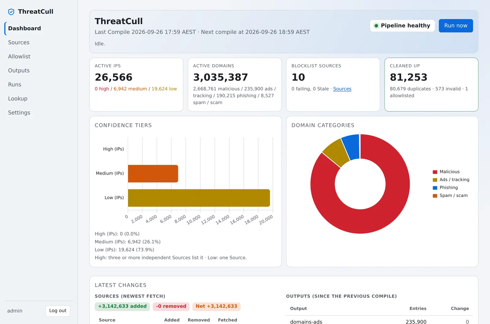
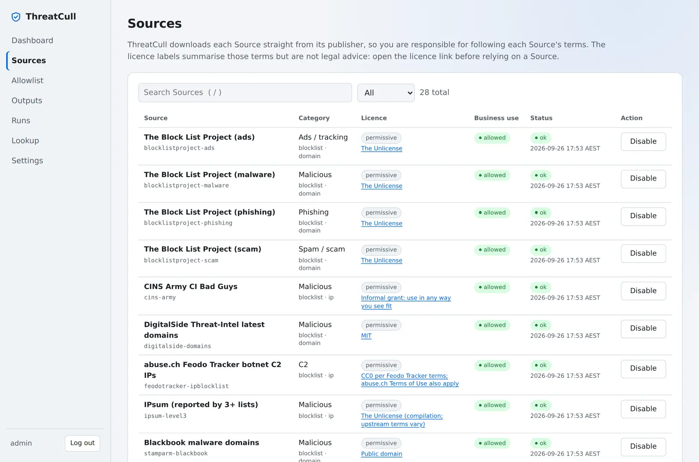
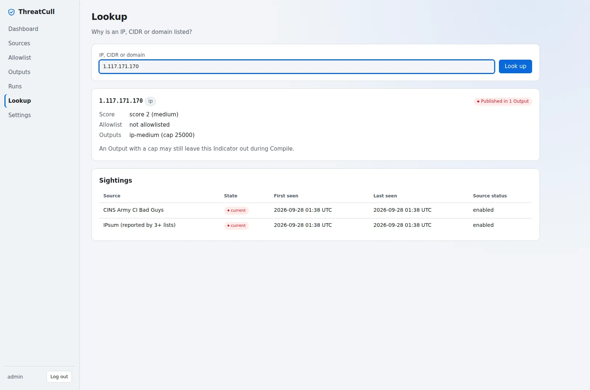

# ThreatCull

[](https://github.com/spydisec/threatcull/releases/latest)
[](https://coderabbit.ai)
[](https://github.com/spydisec/threatcull/actions/workflows/image-scan.yml)
[](https://github.com/spydisec/threatcull/pkgs/container/threatcull)
[](pyproject.toml)
[](LICENSE)
[](https://deepwiki.com/spydisec/threatcull)

Self-hosted threat-feed compiler. ThreatCull downloads public blocklists, drops duplicates, private
ranges and your own infrastructure, scores each indicator by how many independent sources list it, and
serves the result to your firewalls, DNS servers and SIEM.

It's for anyone who runs a firewall, DNS filter or SIEM and wants one curated blocklist instead of many
raw ones. ThreatCull ships no threat data and doesn't block traffic itself: your devices fetch its
lists.

```text
sources ──> drop duplicates, private ranges, your allowlist ──> score by source agreement ──> feed URLs
```

- [Catalog](docs/CATALOG.md) of public blocklist sources, plus your own sources (URL or local file)
- Built-in CDN allowlists, your own entries and your own allowlist URLs; mark your own network to
  get an alert when a source lists it
- Confidence tiers (high, medium, low) from source agreement
- Outputs as plain, hosts, AdGuard, RPZ, CSV or JSON, each at its own URL with a Feed Token
- Web UI with a dashboard, lookup, run history and a built-in scheduler
- Works offline and on a bare LAN IP

A short tour of the web UI:

https://github.com/user-attachments/assets/d78a93ce-2fdb-4fbf-9664-20ed0162c54a

<table>
  <tr>
    <td width="33%" align="center">
      <a href="docs/images/dashboard-light.webp"><picture><source media="(prefers-color-scheme: dark)" srcset="docs/images/dashboard-dark.webp"></picture></a>
      <br><sub><b>Dashboard</b></sub>
    </td>
    <td width="33%" align="center">
      <a href="docs/images/sources-light.webp"><picture><source media="(prefers-color-scheme: dark)" srcset="docs/images/sources-dark.webp"></picture></a>
      <br><sub><b>Sources</b></sub>
    </td>
    <td width="33%" align="center">
      <a href="docs/images/lookup-light.webp"><picture><source media="(prefers-color-scheme: dark)" srcset="docs/images/lookup-dark.webp"></picture></a>
      <br><sub><b>Lookup</b></sub>
    </td>
  </tr>
</table>

<sub>Click a screenshot to open it full size.</sub>

## Quick start

You need Docker with Compose. The image is published for amd64 and arm64. ThreatCull runs on these
platforms:

| Platform | Status |
| --- | --- |
| Docker on Linux, amd64 or arm64 (servers, VMs, a Raspberry Pi with a 64-bit OS) | Supported and tested |
| Docker Desktop on Windows (WSL 2) or macOS | Runs the same Linux image; not tested |
| 32-bit ARM, such as 32-bit Raspberry Pi OS | Not supported: no image is published |
| Windows without Docker | Not supported: use Docker Desktop or WSL 2 |

Keep the `threatcull-data` named volume from the compose file, especially on Docker Desktop.
Don't mount a Windows folder (such as `C:\threatcull`) as `/data`: the SQLite database needs file
locking that such mounts don't provide reliably, and the database can lock up or corrupt.

To start ThreatCull:

1. Download the compose file:

   ```bash
   curl -fsSLO https://raw.githubusercontent.com/spydisec/threatcull/main/docker-compose.yaml
   ```

2. Set `THREATCULL_ADMIN_PASSWORD` in `docker-compose.yaml` (12 or more characters).
3. Start the container:

   ```bash
   docker compose up -d
   ```

4. Open `http://<server-ip>:6969` and log in as `admin`.

ThreatCull reads the password on the first start only; you can clear it from the file afterwards.
Data lives on the `threatcull-data` volume.

**Portainer:** go to **Stacks > Add stack**, paste `docker-compose.yaml`, set the password, then click
**Deploy**.

### Air-gapped install

On a machine with internet access, pull and save the image:

```bash
docker pull ghcr.io/spydisec/threatcull:2
docker save ghcr.io/spydisec/threatcull:2 -o threatcull.tar
```

Copy `threatcull.tar` and `docker-compose.yaml` to the air-gapped machine, then load the image there:

```bash
docker load -i threatcull.tar
```

Start it with `docker compose up -d` as usual. Add
Sources as `file://` URLs for files in `/data/imports/`, and update the Catalog by uploading the
file. The web UI loads nothing from the internet.

## First steps

1. On **Sources**, enable the lists you want.
2. On **Outputs**, rotate a Feed Token to get the feed URL. Tokens show once.
3. Click **Run now**, or wait for the schedule: each Source refreshes on its own interval, and the
   Outputs update every hour.
4. Point your firewall or DNS server at the feed URL:

```bash
curl http://<server-ip>:6969/o/ip-high/<feed-token>
```

## Settings

Set these under `environment:` in `docker-compose.yaml`.

| Variable | Default | What it does |
|---|---|---|
| `THREATCULL_ADMIN_PASSWORD` | none | Creates the `admin` user on the first start (12 or more characters) |
| `THREATCULL_ADMIN_PASSWORD_FILE` | none | Same, read from a file such as a Docker secret; wins over the above |
| `TZ` | `UTC` | Timezone for times in the web UI, as an IANA name such as `Australia/Melbourne` |

ThreatCull stores and schedules everything in UTC, so you can change `TZ` at any time. Hover a time
in the web UI to see its UTC value.

### Sizing

What ThreatCull needs depends on how many lines your enabled Sources list, not on the platform. It
runs the same on a single-board computer, a small VM or a large server; bigger lists take
longer on slower processors and disks.

Measured with `scripts/bench.py` on an 8-core x86 machine with an SSD:

| Lines (unique) | First Fetch | Unchanged re-Fetch | Compile | Peak memory | Database |
|---|---|---|---|---|---|
| 500,000 IPs (300,000) | 14 s | 1 s | 8 s | 79 MB | 45 MB |
| 1,000,000 domains (600,000) | 19 s | 1 s | 16 s | 79 MB | 96 MB |
| 3,000,000 domains (1,800,000) | 79 s | 3 s | 56 s | 79 MB | 287 MB |

- **Memory** stays under about 100 MB for lists of any size: downloads go to a temporary
  file and are read line by line.
- **Disk:** plan on about 100 MB of database per million unique entries, plus the Output files.
  Settings and the dashboard show the current sizes.
- **Time** grows with the number of lines. A Source whose list hasn't changed is skipped in
  seconds, so only the first Fetch, and Fetches of lists that change, take long.

Run `uv run python scripts/bench.py --lines 1000000` on your own host for numbers that apply to it.
On a small host (1 to 2 GB of RAM, an SD card or a slow disk, as on a Raspberry Pi or a small
VPS):

- start with the catalog's default Sources and add large lists one at a time;
- remove the `#` in front of `mem_limit: 1g` in `docker-compose.yaml`, so Docker stops ThreatCull
  before the host runs out of memory, and watch `docker stats` during the first Fetch of a large
  list;
- keep other busy containers off the same SD card if you can: database writes compete for it.

## Upgrade

To upgrade, pull the new image and restart:

```bash
docker compose pull && docker compose up -d
```

The `:2` tag follows 2.x releases. Pin a version such as `:2.0.0` to upgrade by hand. Sources you
disabled stay disabled.

**Catalog only:** to pick up new or corrected sources between releases, use **Check for updates**
on the Sources page, or run `threatcull catalog update`. New sources arrive disabled. Without
internet access, upload a newer `catalog.yaml` there, or run `threatcull catalog update --file`.

## Back up and restore

ThreatCull has two backups. Keep ThreatCull's address stable (a DHCP reservation or a local DNS
name), because feed URLs contain it.

### Configuration backup (recommended)

Export the configuration to a file:

```bash
docker compose run --rm -T threatcull config export > threatcull-config.yaml
```

**Settings > Configuration > Export** in the web UI does the same. The file holds settings, Source
choices, custom Sources, the allowlist (including My network), Outputs, and the hashes of your Feed
Tokens and API tokens. It never holds passwords, raw tokens or threat data.

To restore on a fresh install, import the file with `--restore-tokens`:

```bash
docker compose run --rm -T threatcull config import --restore-tokens - < threatcull-config.yaml
```

The command restores Feed Tokens and API tokens. In the web UI, tick **Restore Feed Tokens from the
file** on Settings and import the file: it restores Feed Tokens only, and API tokens need the command
above. Old feed URLs keep working, so your devices keep pulling their feeds. The feeds stay empty until
the next Compile, so click **Run now**.

Once everything works, rotate your Feed Tokens on the Outputs page and update each device. Rotating
retires the hashes stored in the backup file, which matters most if others may have seen the file.

Without the option, an import never adopts the hashes in the file, so importing a file someone else
shared gives them no access. If API tokens belonged to users other than `admin`, create those users
before you import.

### Full database backup (optional)

This copies the whole database. It works while ThreatCull runs:

```bash
docker compose run --rm threatcull backup create
```

The command prints the file's path, for example `/data/backups/threatcull-20261102T092437Z.db`.
Copy the file off the host into the current folder:

```bash
docker compose cp threatcull:/data/backups/threatcull-20261102T092437Z.db .
```

To restore on the same host, stop ThreatCull, restore the file, then start it again:

```bash
docker compose stop
docker compose run --rm threatcull backup restore /data/backups/threatcull-20261102T092437Z.db
docker compose start
```

To restore on a new host, put the backup file next to `docker-compose.yaml`, make it readable by the
image's user, and mount it into a one-off container. Run this before you first start ThreatCull, or
after `docker compose stop`:

```bash
chmod 644 threatcull-20261102T092437Z.db
docker compose run --rm -v "$PWD/threatcull-20261102T092437Z.db:/restore.db:ro" threatcull backup restore /restore.db
docker compose up -d
```

The backup file is private (mode 0600) and the image's user can't read it otherwise. Restore copies
it into the volume, so delete your copy or set it back with `chmod 600` afterwards.

Restore refuses to run while ThreatCull runs. It checks the file first and refuses a backup from a
newer ThreatCull. It keeps a safety copy of the current database as `/data/backups/pre-restore-…db`.
Because the ThreatCull container must be stopped, `docker exec` into it can't work. Use
`docker compose run --rm`, which starts a one-off container as the image's own user.

### What neither backup holds

Some things live outside the database and are in neither backup. Get the Catalog update again with
**Check for updates** on the Sources page, or upload the Catalog file if you are offline. Copy the
data directory's `imports/` folder across by hand. The session secret isn't backed up either, so
everyone logs in again after a restore on a new host.

## Run without Docker

This needs Linux or macOS with Python 3.12 or newer and [uv](https://docs.astral.sh/uv/). Windows
isn't supported without Docker. To install and start it:

```bash
git clone https://github.com/spydisec/threatcull.git && cd threatcull
uv sync
uv run threatcull init
uv run threatcull user create admin
uv run threatcull serve --host <lan-ip> --port 6969
```

`init` prints each default output's Feed Token once. `uv run threatcull --help` lists every command.

## Notes

- **Offline networks:** add a custom source with a `file://` URL. Sources added in the web UI must
  point to files in the data directory's `imports/` folder (`/data/imports/` in Docker).
- **Ranges:** outputs list single IP addresses and domains. A source that lists a CIDR range counts on
  the dashboard as "Ranges left out", because one range can block many unrelated hosts. Ranges on
  the allowlist still cover every address inside them.
- **Frozen sources:** a blocklist source whose list has not gained or lost an entry for 30 days
  (`frozen_after_days`) shows as **frozen** on the Sources page and the dashboard. Its entries still
  count; check the feed and disable it if the publisher stopped updating it.
- **Your network:** add your public addresses to the allowlist with **My network** ticked (or run
  `threatcull allow detect`). ThreatCull keeps them out of every output and warns you when a source
  lists one.
- **Scripts:** create an API token with
  `docker exec threatcull threatcull api-token create <name> --user admin` and send it as
  `Authorization: Bearer <token>` to `/api/v1/`. [docs/API.md](docs/API.md) lists every endpoint.
- **Hardening:** the image is built on [Docker Hardened Images](https://docs.docker.com/dhi/) (no
  shell or package manager inside) and runs as a non-root user. The compose file drops all Linux
  capabilities and blocks privilege escalation. It also works with `read_only: true` and
  `tmpfs: [/tmp]`: SQLite writes its temporary files to `/data`, so they don't use RAM.
- **Reverse proxy with TLS:** start `serve` with `--secure-cookies` and `--trusted-proxy <proxy-ip>`.
- **Scheduling:** `serve` runs fetches and compiles itself. `threatcull run` refuses to start while
  `serve` runs on the same data directory, so don't schedule it from `cron` as well.

## Sources

ThreatCull ships no threat data. Each install downloads every source straight from its publisher, and
you decide which sources to use. The Sources page links each one to its feed, so you can see who
publishes it and follow their terms.

## Development

To set up a development checkout and run the checks:

```bash
make setup   # dependencies and git hooks
make check   # lint, types and security checks, as in CI
```

See [CONTRIBUTING.md](CONTRIBUTING.md) for reporting issues and suggesting changes, [SECURITY.md](SECURITY.md)
to report a vulnerability, and [CHANGELOG.md](CHANGELOG.md) for what changed in each release.

## Licence

[GNU AGPL-3.0](LICENSE)
